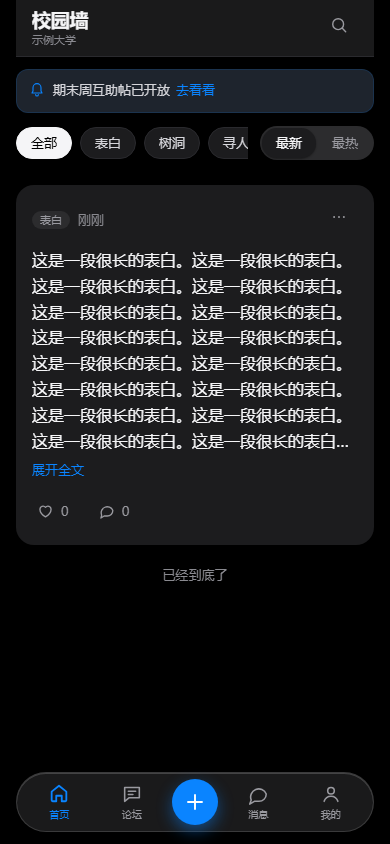
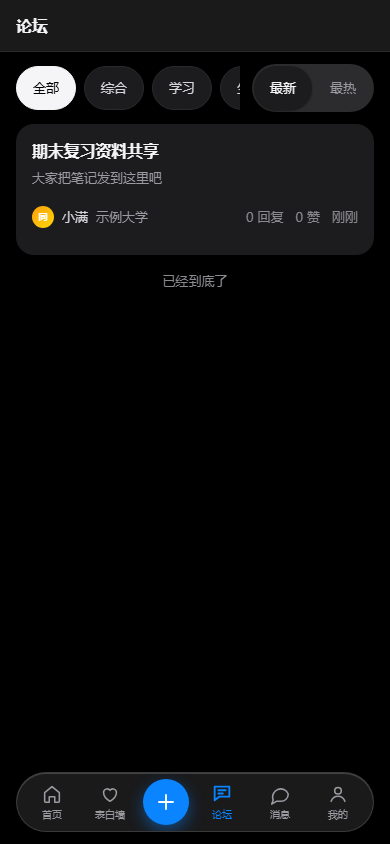
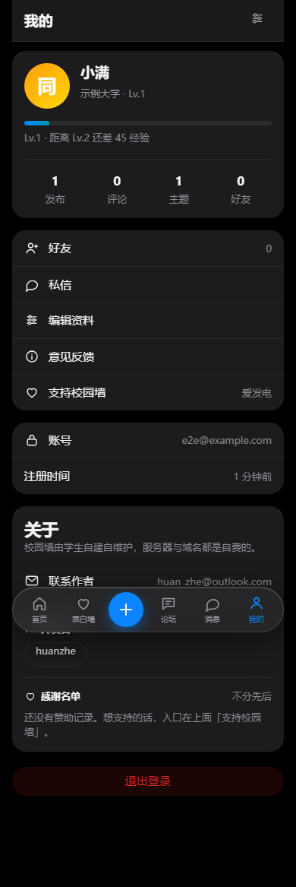

# 校园墙 v1.0.1

校园表白墙（正式版）：**匿名表白 + 署名论坛 + 好友私信**。
React（Vite）前端 + 纯 Node 后端（node:http + SQLite），为最低配置 VPS 设计，没有任何第三方服务依赖。

- 前端：React 18，移动优先，底部液态玻璃 dock，深色模式跟随系统
- 后端：Node 内置 http + better-sqlite3（唯一依赖），单进程、WAL、零外部服务
- 登录：**邮箱或手机号 + 验证码**（Brevo 发送），无密码；用户对外标识是 **uuid**
- 首页：**一整块 Markdown**，后台可编辑（写介绍、规则、活动），保存立即生效
- 内容：表白墙在 `/#/wall`（**匿名**），论坛在 `/#/forum`（**署名**：昵称 · 学校 · 头衔 · 等级）；
  两类都**先过违规词库，干净内容直接发布**

| 首页（手机 · 深色） | 论坛 | 我的 |
| --- | --- | --- |
|  |  |  |

> 截图为 `npm run e2e` 在 390×844 无头浏览器里真实渲染出来的（不是设计稿）。

---

## 1. 快速开始

```bash
npm install            # 会顺带构建前端（prepare 钩子）
npm --prefix server install

# 后端（终端 A）
cp server/.env.example server/.env     # Windows: copy server\.env.example server\.env
#   至少要改：ADMIN_TOKEN、IP_HASH_SECRET、CF_*（邮件）
npm run server

# 前端开发服务器（终端 B，可选，改前端时用）
npm run dev            # http://127.0.0.1:5173，/api 代理到 8080
```

安全审计与加固记录见 [SECURITY.md](SECURITY.md)（含 SQL 注入专项结论与攻击面回归测试）。\n\n生产部署看 [DEPLOY.md](DEPLOY.md)（反向代理、systemd、面板部署、HTTPS）。

**上线前必做三件事**：

1. `server/.env` 里配好 Cloudflare 邮件通道（否则没人收得到验证码，只能看服务端日志）——
   配完到后台**概览 → 邮件通道**点一次「发送测试邮件」，通不通立刻知道；
2. 登录后台 `/houtai/`，在「学校管理」里加学校 —— **名单为空时新用户无法完成注册**；
3. 在「公告」里写一条首页公告（可选，但空着首页会少一块信息）。

## 2. 目录

```
web/src/
  App.jsx            外壳：路由分发 + dock + 全局弹层
  router.jsx         hash 路由（60 行，替代 react-router）
  api/client.js      唯一的网络出口（所有接口在这里收口）
  context/           AuthContext（登录态）、ToastContext
  components/        Dock / Sheet / PostCard / UserBadge / Avatar / Empty / icons
  pages/Home.jsx     首页（公告 + 分类 + 信息流）
  forum/             论坛：列表 / 详情 / 发帖
  social/            消息：会话列表 / 聊天 / 好友
  me/                账号：登录弹层 / 我的主页 / 他人主页 / 设置 / 反馈
  styles/            tokens（唯一允许写颜色的地方）+ global/app/wall/sheets/me/forum/social

server/
  src/server.js      路由与 HTTP 层（单文件；业务拆到下面的模块）
  src/users.js       账号、会话、验证码、头衔、等级、学校
  src/email.js       Cloudflare Email Service（REST）发信 + 未配置时的降级
  src/forum.js       论坛：主题、回复、点赞、审核队列
  src/social.js      好友关系与私信
  src/announce.js    首页公告
  src/moderation.js  内容预筛 + **昵称预审**（词表热重载）
  src/db.js          SQLite 连接、迁移、维护
  schema.sql         表结构与索引（含每条索引的理由）
  data/banned.txt    预审词表（公开词库整理，可自行增删）
  public/admin.html  审核后台（单文件，无构建）
```

## 3. 账号系统

| 能力 | 说明 |
| --- | --- |
| 登录方式 | **邮箱或手机号任选其一** + 6 位验证码。**没有密码**，也就不存在密码泄露与撞库 |
| 发信通道 | Cloudflare Email Service（REST）。未配置时降级到服务端日志 + `server/data/outbox/` |
| 对外标识 | `uuid`（自增 id 不对外：它会泄露注册顺序，也不能跨库迁移） |
| 昵称 | 2–16 字，注册时**本地预审**：命中违禁词/联系方式/冒名官方 → 直接拒绝 |
| 学校 | **登录时强制选择，选定后不可更改**（`PATCH /api/me` 不接受该字段，后台也没有改学校的入口） |
| 个性化 | 昵称（7 天冷却）、预设头像、一句话简介。不做图片上传：成本与审核风险都不划算 |
| 人机验证 | 可选：配置 `TURNSTILE_*` 后，「获取验证码」必须先过 Cloudflare Turnstile |
| 手机号 | 可直接用来注册；邮箱注册的账号也能在「设置」里绑定（短信验证码），之后用手机号登录 |
| 发信通道 | Brevo（邮件 + 短信，推荐）或 Cloudflare Email Service（仅邮件），见 `MAIL_PROVIDER` |

**两种验证码通道**：邮箱与手机号共用同一套流程（发码 → 限流 → 5 次错误作废 → 校验），
区别只是投递方式。**用户自选**：注册时填邮箱或手机号都行，不强制先有邮箱
（`users.email` 因此可空，数据库用 CHECK 保证「至少有一个登录身份」）。四个要点：

- **手机号可以直接注册**：未注册的号码也能收到验证码 —— 但短信是花钱的，
  所以「新号码注册」额外限流（每号码 1 次/小时、每 IP 3 次/小时），叠加 Turnstile。
  已注册号码走登录，不受这条限制。
- **手机号注册的账号解绑会被拒绝**：没有邮箱就没有第二个登录身份，解绑等于把自己锁在门外。
- **发码一律过人机验证**（含绑定手机号的发码，`action=bind_phone`）：短信比邮件更贵，
  「用户已登录」不等于「不是脚本」。
- 老库升级时会把 `users.email` 从 NOT NULL 迁移成可空（整表重建，带数据与外键校验）。

**人机验证（可选，线上强烈建议开）**：只保护「发送登录验证码」这一个入口 —— 它是全站唯一会
对外发信、也是注册漏斗的第一道门；写入侧另有「违规词库 + 限流 + 脚本 UA 拦截」兜底，
不需要每个动作都弹验证。全站级的机器人质询放在 Cloudflare 边缘（见 DEPLOY.md ⑪）。
服务端做 canonical siteverify，并**同时比对 action 与 hostname 白名单**：只校验 `success` 是不够的，
那等于允许别的站点签发的 token 来打我们的发码接口。未通过返回 400/403；Cloudflare 不可达时
fail-closed（503）—— 宁可暂时登不上，也不在验证服务挂掉时对全网站开门。
部署注意：widget 的 **Hostname Management** 里要包含正式域名（本地开发再追加 `localhost`）。
| 头衔 | 后台自定义（名称/颜色/自动授予等级）；手动指定优先于自动头衔 |
| 等级 | 由经验推导（三角曲线：L2=50、L3=150、L4=300…）。经验来自发帖、评论、被点赞、每日登录 |

**展示顺序固定为「学校 → 头衔 → 等级」**（`UserBadge`），空间不足时依次省略等级、头衔，
绝不留下悬空的分隔符。

## 4. 三个内容场域

| | 表白墙 | 论坛 | 私信 |
| --- | --- | --- | --- |
| 署名 | **完全匿名**（前台不返回任何作者字段） | 署名：昵称 · 学校 · 头衔 · 等级 | 署名 |
| 审核 | 过词库即发布，命中才转人工（`CONTENT_PREMOD=1` 可切全量先审） | 同左（`FORUM_PREMOD=1` 可切全量先审） | 不过预筛，靠好友关系 + 拉黑 + 限流 |
| 访问 | 浏览免登录，互动需登录 | 同左 | 仅好友 |

表白墙**已取消正文字数上限**（只要求非空，真正的边界是请求体上限 `MAX_BODY`）；
长文在信息流里默认折叠 8 行，点「展开全文」看完整内容。

## 5. 好友与私信

- 加好友是**请求—同意**式：对方已向我发过请求时，我这边一按即成为好友（微信/QQ 的「互相添加」）。
- 只有好友之间能私信；拉黑会**解除好友关系**并拒收私信，对方只会看到「对方已限制你的访问」。
- 会话列表带未读数，底部 dock 的「消息」上有红点（轮询 30 秒；进入会话即标记已读）。
- 没有「全局搜索用户」这种接口 —— 加好友靠 uuid 或对方主页链接，从设计上避免被扫号。

## 6. 后台 `/houtai/`

单文件、无构建，靠 `ADMIN_TOKEN` 鉴权（`Authorization: Bearer …`）。含：

- **概览**：待办、**来源与设备**（IP 国家/地区 + 访问设备分布，粗粒度不落完整 IP）、
  库体积、用户规模、今日活跃、邮件/短信通道状态
- **命中待复核**：只收命中违规词库的帖子 / 评论 / 主题 / 回复，四类切换，逐条放行或驳回
- **用户详情**：手机号与验证状态、IP 来源 / 访问设备 / 打码 IP、在线会话数、赞助记录；
  操作含设头衔/等级/经验、改名、封禁禁言、**强制下线**、**解绑手机号**、**重置昵称冷却**
- **举报工单**、**审核日志**、**意见反馈**
- **用户**：搜索与筛选、详情（邮箱、uuid、昵称与预审标记、学校、简介、头衔、等级、经验、
  状态、注册/最近登录、IP/UA 哈希、各项内容计数、最近发布与私信）、
  动作（设头衔、设等级、设经验、改名、封禁/禁言、清除昵称标记）
- **头衔**：增删改，自动授予按等级生效
- **公告**：首页公告的增删改与启停
- **学校**：名单维护（**名单为空时新用户无法注册**；删除学校不影响已选该校的用户）
- **赞助**：爱发电订单列表、待绑定队列、手动绑定/忽略、手动补单、回调排查

> 老地址 `/admin` 是一个钓鱼页，只为了给扫描器降噪 —— 真正的防线是令牌校验 + **不要把后台暴露在公网**（建议 SSH 隧道）。

## 7. 赞助（爱发电，可选）

配置入口：**https://afdian.com/dashboard/dev**，把页面上的三样东西填进 `server/.env`：

```bash
AFDIAN_USER_ID=        # 开发者页的「用户 ID」
AFDIAN_TOKEN=          # 开发者页的「API Token」
AFDIAN_PAGE=           # 你的爱发电主页，如 https://afdian.com/a/yourname
```

然后在开发者页把**回调地址**填成 `https://<你的域名>/api/afdian/webhook`。

**怎么发奖（全自动，无需审批）**：App 的「我的 → 支持校园墙」给出一段可直接复制的留言模板，
用户整段粘进爱发电的「留言」框即可。默认档位：

| 发电金额 | 自动获得 |
| --- | --- |
| ≥ 5 元 | 固定头衔「**股东**」 |
| ≥ 10 元 | **自定义头衔** —— 留言里写 `头衔：想要的名字` |

规则细节：

- 档位表由 `AFDIAN_REWARD_TIERS` 配置（默认 `5:股东;10:@custom`，`@custom` = 用留言里自填的头衔），
  取「**不超过订单金额的最高档**」。加档只改这一行，不需要改代码。
- 自定义头衔会过一遍**与昵称相同的预审**（违禁词、联系方式、冒名官方）——
  否则花 10 元就能叫「管理员」。不合格时自动回落到低一档的固定头衔，并在订单上记录原因。
- **管理员手动指派的头衔不会被赞助覆盖**；赞助头衔之间可以逐档升级（先 5 元后 10 元能升上去）。
  判定依据是订单上记录的 `title_id`：当前头衔是不是赞助发的。
- 留言漏填或没匹配到的订单不会丢，进后台「赞助」页的待绑定队列，管理员可手动认领。
- 低于最低档的订单只记录、不发奖。

实现上的三个要点：

- **签名**照官方算法 `md5(token + "params" + params + "ts" + ts + "user_id" + user_id)`，
  用定长比较；`AFDIAN_TOKEN` 未配置时**拒绝一切回调**（否则谁都能伪造一笔赞助来骗头衔）。
- **幂等**靠 `out_trade_no` 唯一约束：爱发电没收到 `{"ec":200,"em":""}` 会重试，
  重试退化成一次 `INSERT OR IGNORE`，不会重复发奖。
- **回调原文会留痕**：签名不对、格式不认识时把报文截断记进审计日志与后台的「回调排查」区，
  第一笔真实回调就能看出真实格式，不必靠猜。

未配置时整条链路静默关闭：接口 404、App 不显示入口，其余功能不受影响。

## 8. 审核与合规

- 内容预筛（`moderation.js`）：NFKC 归一化 + 去零宽字符 + 词表热重载（改 `banned.txt` 无需重启）。
  命中即转人工，**不自动删除** —— 误判的代价只是多一次人工复核。
- 昵称是例外：**命中直接拒绝**。昵称会出现在全站每个角落，先进队列等于先污染后收拾。
- 不落盘原始 IP，只存 HMAC-SHA256 哈希；验证码与会话 token 也只存哈希。
- 举报工单 + 通知—移除 + 操作留痕（`audit_log`）三条链路都在。

## 9. 配置

全部集中在 `server/.env`（模板见 [server/.env.example](server/.env.example)）。最常改的几项：

| 变量 | 作用 |
| --- | --- |
| `ADMIN_TOKEN` / `IP_HASH_SECRET` | 后台令牌 / 哈希密钥（生产必改，32 位随机串） |
| `CF_ACCOUNT_ID` `CF_EMAIL_TOKEN` `CF_EMAIL_FROM` | Cloudflare 邮件通道（发验证码） |
| `SITE_NAME` | 站点名（前端标题与邮件标题） |
| `SESSION_DAYS` `NICKNAME_COOLDOWN_H` `FORUM_PREMOD` | 会话时长 / 改名冷却 / 论坛审核口径 |
| `DB_PATH` `RETENTION_DAYS` | 数据库位置 / 数据保留天数（0 = 不按时间清理） |
| `FEATURE_FORUM` `FEATURE_DM` | 关掉论坛或私信 |

前端**不需要任何环境变量**：站点名、公告、功能开关都由 `GET /api/site` 下发，改文案不用重新构建。

## 10. 测试与验收

```bash
npm run verify          # 设计系统检查 + 构建 + 后端测试 + 浏览器 e2e
npm --prefix server test   # 只跑后端：接口全链路 + 路由巡检 + 数据库体检
npm run e2e                # 只跑浏览器端到端（需要本机有 Edge/Chrome）
```

| 套件 | 覆盖 | 规模 |
| --- | --- | --- |
| `server/scripts/api-test.js` | 注册/登录/预审/发帖/审核/点赞/评论/论坛/好友/私信/拉黑/头衔/等级/后台，共 150+ 条断言 | 154 |
| `server/scripts/route-sweep.js` | 从源码抠出**每一条注册路由**真打一遍，断言无 5xx | 60 条路由 |
| `server/scripts/db-check.js` | 表/索引齐全、完整性、外键、缓存计数一致性 | 20+ 项 |
| `scripts/e2e.mjs` | 真实构建 + 真实后端 + 无头浏览器：首页/dock/注册/发帖/审核/论坛/移动端适配 | 24 |
| `scripts/check-tokens.py` | 设计令牌完整性、`var()` 引用有效、颜色字面量只出现在 tokens.css | 8 CSS + 26 JSX |

测试用的数据库与 outbox 都在临时目录，跑完即删，不会污染 `server/data/`。

## 11. 已知取舍

- **不做图片上传**：头像用预设图形 + uuid 派生的稳定配色。校园场景里图片是最贵也最危险的 UGC。
- **不做全局用户搜索**：只能按 uuid / 主页链接加好友，避免被扫号。
- **不做实时推送**：私信与红点靠轮询（30 秒 / 5 秒）。长连接在最低配 VPS 上不划算。
- **论坛不做全量先审**（默认）：讨论需要即时性，预筛 + 人工抽查 + 事后下架是更合适的组合。
